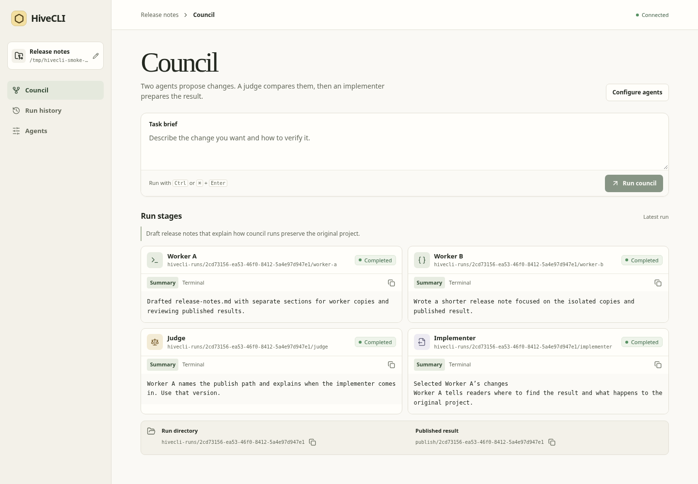

# HiveCLI

HiveCLI is a local workbench for comparing AI coding agents on the same task. Two workers start from the same project snapshot, a reviewer compares their changes, and an implementer assembles the result. The workbench shows each stage's output and keeps the resulting files available for inspection.



## Quick start

Use Node.js 24 LTS, pnpm 10, and a supported coding CLI such as [Codex CLI](https://github.com/openai/codex). Linux installations of the native terminal module need Python, Make, and a C++ compiler.

```sh
pnpm install --frozen-lockfile
pnpm start
```

Open [the workbench](http://localhost:1420), choose a project directory on the machine running HiveCLI, and enter a task. The orchestrator runs on port 45231.

Sign in through your coding CLI before starting a live run. HiveCLI uses the CLI's existing authentication. The default Codex preset uses the model configured in Codex, with low reasoning effort. To use a different model, open **Agents** and insert `"-m", "<model>"` before `"--"` in the argument list.

## How a run works

1. **Workers** run in parallel against separate copies of the same source snapshot.
2. **Reviewer** inspects the candidates and their file differences, then recommends a candidate or a specific merge.
3. **Implementer** accepts a candidate as-is or makes a merge in a separate copy.
4. **Result** is written to `publish/<task-id>/` inside the selected project. Open the result and review it before applying changes to your project.

Snapshots, candidate folders, and comparison artifacts live under `hivecli-runs/<task-id>/`. Reopen past prompts, summaries, and terminal output from **Run history**. Coding CLIs can send task context to their configured providers. Use a project and CLI configuration you trust.

## Development

```sh
pnpm build
pnpm typecheck
pnpm test
pnpm exec playwright install chromium
pnpm test:ui
```

The Playwright smoke test starts an isolated copy of both services and runs a complete council using deterministic local fixtures. It requires no provider account or model credits. Set `HIVECLI_CHROMIUM_EXECUTABLE` to use an existing Chromium installation.

| Package | Responsibility |
| --- | --- |
| `apps/desktop` | React workbench, Vite development server, optional Tauri shell |
| `apps/orchestrator` | Express API, WebSocket streaming, SQLite, CLI processes, run artifacts |
| `packages/shared` | Request schemas, types, agent presets, and council prompts |

The browser workflow is the default. To run the optional native shell, install the [Tauri prerequisites](https://v2.tauri.app/start/prerequisites/) and use `pnpm start:tauri`.
